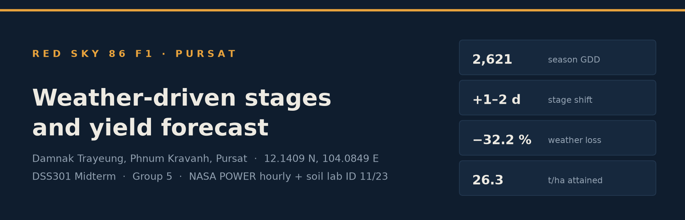
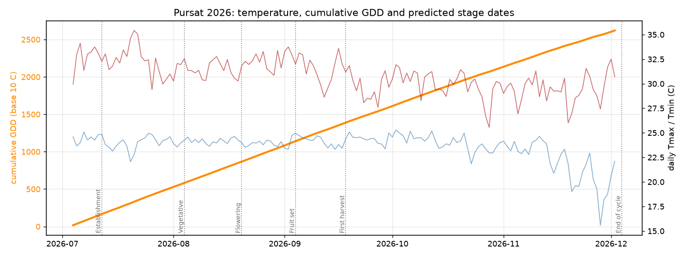
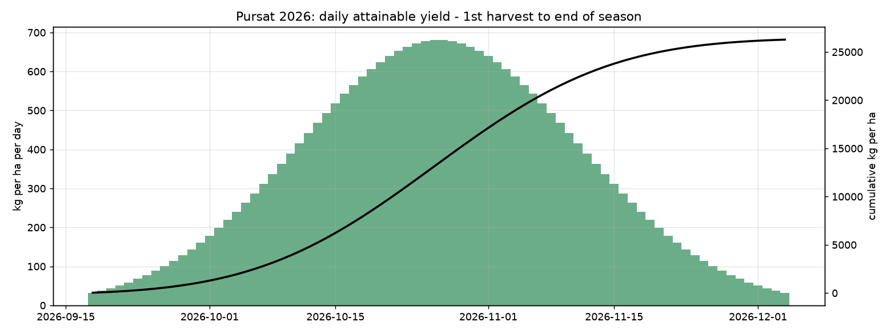
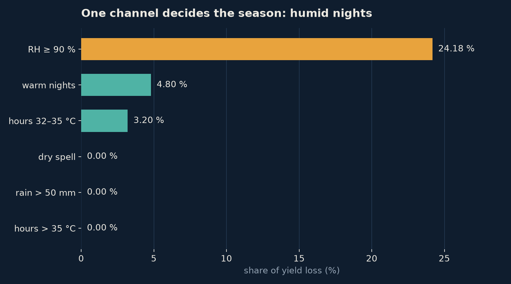
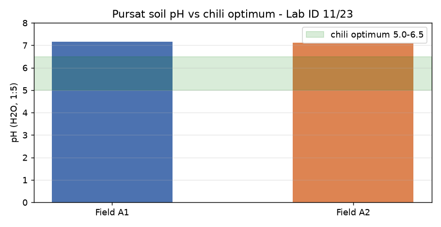
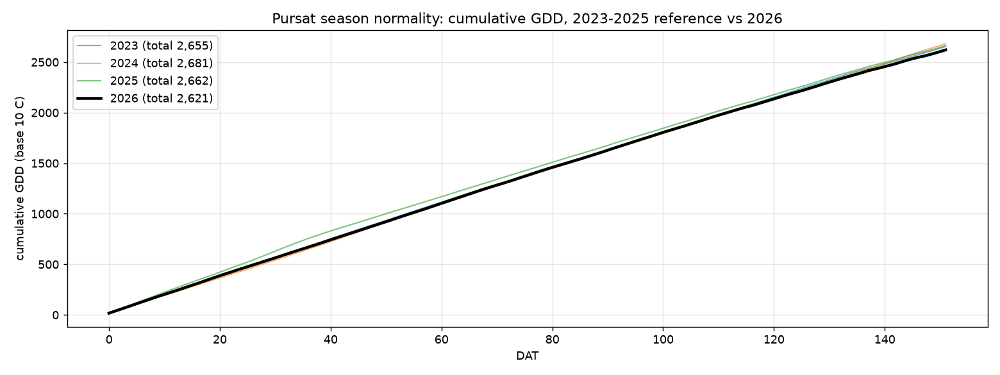

# DSS301 Midterm — Red Sky 86 F1 chili, Pursat

Weather-driven growth-stage and yield analysis for a **Red Sky 86 F1** hot chili field in
**Damnak Trayeung village, Phnum Kravanh district, Pursat province, Cambodia**
(12.140874 N, 104.0848521 E; NASA POWER grid point 12.141 / 104.085, elevation 121.9 m).

Course: DSS301, RUPP Year 3. Transplants 04/07/2026, farm calendar to 02/12/2026.

**Group 5** — Khon Sotheara · Khann Udomvirak · Chea Sela · Cheang Youpheng

> Presentation deck and a 4-speaker script are included: `DSS301_RedSky86_Pursat_Slides.pptx`
> and `PRESENTATION_SCRIPT.md` (13 minutes, 13 slides, Q&A bank).

## Headline results

| Item | Value |
|---|---|
| Season GDD (base 10 °C) | 2,621 |
| Reference seasons 2023–2025 | 2,655 / 2,681 / 2,662 |
| Stage accuracy | all +1 to +2 days vs the standard calendar |
| First harvest | 18/09/2026 |
| Weather-driven loss | −32.18 % |
| Attained yield | 1.051 kg/plant = 26,280 kg/ha |
| Season total | 1,484.8 t (56.5 ha) / 906.7 t (34.5 ha) |

Dominant stress is **disease pressure from humid nights** (1,209 hours with RH ≥ 90 %), not heat:
there are **zero hours above 35 °C** in the sensitive 45–150 DAT window, no day over 50 mm and no
dry spell.

## Visuals

| Cumulative GDD and stage dates | Daily yield distribution |
|---|---|
|  |  |

| Where the loss comes from | Soil pH against the chili optimum |
|---|---|
|  |  |

| Season normality — 2023–2025 reference against 2026 |
|---|
|  |

## Method

1. Hourly NASA POWER data for the season, QA/QC checked (no missing, duplicate or invalid records).
2. GDD accumulation at base 10 °C, thresholds calibrated against three reference seasons
   (2023–2025) at DAT 7 / 30 / 45 / 60 / 75 / 150.
3. Growth stages predicted from those thresholds, compared with the agronomic standard calendar.
4. Six stress channels applied over the sensitive window, capped at 35 % total loss.
5. Bell-shaped daily yield distribution between first harvest and end of cycle.

## Stated limitations

- **13/10/2026 → 02/12/2026 is a labelled 2025 proxy** (MERRA-2 latency). It carries about
  33 % of the modelled loss.
- The **end-of-cycle date is extrapolated**: 2026 reaches 2,621 GDD, short of the 2,649 threshold.
- Potential yield (1.55 kg/plant), planting density (25,000 plants/ha) and the six loss
  coefficients are **assumptions from the method**, not measurements at this field.
- Block counts (113 blocks / 69 plots) are ours, not surveyed; at the brief's 0.5 ha per block
  they give 56.5 ha / 34.5 ha, so tonnages are indicative while per-hectare figures are unaffected.
- NASA POWER is a ~55 km grid; ERA5-Land (~9 km) was used only as a cross-check.

## Data sources

- **Weather** — NASA POWER hourly API (MERRA-2), no key required.
- **Soil** — instructor-supplied laboratory report, Lab ID 11/23 (RUPP): fields A1 and A2, both
  silt loam, pH 7.16 / 7.11 (above the 5.0–6.5 chili optimum), available P 155 / 173 ppm,
  CEC 18.4 / 18.5 cmol(+)/kg.

## Files

| File | Contents |
|---|---|
| `DSS301_Midterm_RedSky86_Pursat.ipynb` | Full analysis, executed |
| `DSS301_Midterm_RedSky86_Pursat.html` | Rendered report with figures |
| `Pursat_weather_hourly_2026_season.csv` | 3,648 rows, 15 NASA POWER parameters |
| `Pursat_GDD_daily_2026.csv` | Daily GDD and cumulative GDD |
| `Pursat_reference_GDD_2023-2025.csv` | Three reference seasons |
| `Pursat_stage_predictions.csv` | Predicted stage dates and offsets |
| `Pursat_daily_yield.csv` | Daily yield distribution |
| `Pursat_soil_lab_11-23.csv` | Soil lab results, A1 / A2 |
| `fig_pursat_*.png` | GDD timeline, daily yield, season comparison, soil pH |
| `fig_slide_loss.png`, `banner.png` | README banner and presentation chart |
| `DSS301_RedSky86_Pursat_Slides.pptx` | 13-slide presentation deck |
| `PRESENTATION_SCRIPT.md` | Speaker script, timings and Q&A bank for four presenters |
| `Links.md` | Source links |
| `AGENTS.md` | Project notes and change log |

## Reproduce

```bash
pip install pandas numpy matplotlib jupyter
jupyter nbconvert --to notebook --execute --inplace DSS301_Midterm_RedSky86_Pursat.ipynb
```

Notebooks are executed from their own folder; all paths are relative.

## License

Coursework — not licensed for reuse.
